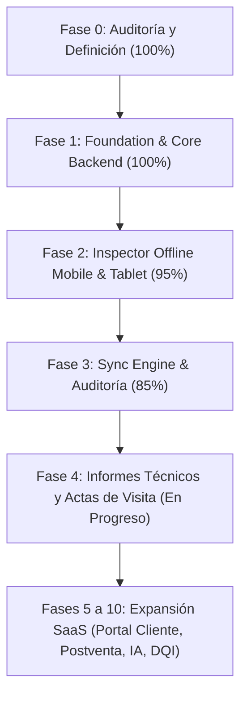

# IMPLEMENTATION PLAN - Plataforma de Inspección Técnica

**Versión:** 2.0 (Alineada con Postmortem y Orientada a Uso en Obra)
**Fecha:** 2026-10-23
**Estado:** Activo / En Ejecución

Este documento describe la planificación técnica detallada y priorizada para la Plataforma de Inspección Técnica Inmobiliaria, integrando los aprendizajes y decisiones del `POSTMORTEM_Y_PLANIFICACION.md`.

---

## 1. Principios Rectores y Filosofía del Proyecto

*   **Enfoque en Campo Primero (Field-First):** La experiencia del ingeniero, arquitecto o técnico en la obra es la máxima prioridad. Los flujos deben requerir como máximo 3 toques para documentar una no-conformidad.
*   **Soporte Multi-Formato Universal (Mobile & Tablet):** Los profesionales técnicos en obra utilizan indistintamente teléfonos móviles y tablets (iPad / Android). Toda la experiencia debe operar con diseño responsivo y adaptativo fluido en ambos formatos.
*   **Entrega de Valor Inmediata (Documento Técnico de Visita):** Cada visita técnica culmina en la generación inmediata del **Acta o Informe Técnico formal (PDF/Impreso)** con evidencia fotográfica, ubicación en plano y cuadro de firmas.
*   **Offline por Defecto:** Toda captura de datos, fotos y marcadores se guarda localmente en SQLite/Drift con verificación criptográfica SHA-256. La sincronización hacia la nube ocurre en segundo plano de manera transparente.
*   **Escalabilidad a Futuro sin Rediseño:** La arquitectura de base de datos multi-tenant (`organizations`, `projects`, `clients`, `appointments`, `audit_logs`) ya se encuentra desplegada y lista para expandirse a módulos SaaS sin alterar los contratos existentes.

---

## 2. Herramientas y Entorno de Desarrollo

*   **Control de Versiones:** Git + GitHub (`https://github.com/lucyb11j/InspectorApp`)
*   **Monorepo:** `pnpm workspaces` (gestión unificada de paquetes y contratos TypeScript compartidos)
*   **Motor Backend:** Supabase (PostgreSQL 17, GoTrue Auth, Storage S3-compatible, RLS estricto)
*   **App Inspector (Campo):** Flutter + Dart + Drift/SQLite (diseño responsivo para Smartphones y Tablets)
*   **Web Admin y Portal de Informes:** Nuxt 3 + Vue 3 + TypeScript (Node.js v22 LTS)
*   **Motor de Pruebas:** Vitest (suite unificada de contratos, hashing y sincronización)
*   **Contenedores:** Docker / Supabase Local CLI

---

## 3. Estado de Fases y Roadmap Actualizado

---

### FASE 0 — Definición y Auditoría GAP (Completada - 100%)
* Análisis arquitectónico de OpenInspection (`OPENINSPECTION_GAP_ANALYSIS.md`).
* Definición de contratos de dominio y diseño de base de datos (`DATABASE.md`, `API_SPECIFICATION.md`).
* Salvaguarda de licencias y propiedad intelectual (`THIRD_PARTY_LICENSES.md`).

---

### FASE 1 — Foundation (Infraestructura Core) (Completada - 100%)
* Monorepo configurado con `pnpm` workspaces y tipados `@inspector/shared-types`.
* Esquemas relacionales con aislamiento Multi-Tenant por `organization_id` y RLS habilitado.
* Migraciones aplicadas:
  * `20261008000000_core_schema.sql` (organizaciones, proyectos, usuarios, inmuebles).
  * `20261008000001_offline_inspector_schema.sql` (áreas, observaciones, evidencias).
  * `20261022000000_appointments_and_services_schema.sql` (servicios y citas).
  * `20261022000001_property_plans_and_markers.sql` (planimetría y pines de planos).
* Seed de desarrollo con usuario demo administrativo autenticado vía GoTrue.
* Corrección integral de roles (`ADMIN`), variables de entorno y soporte nativo Node 22.

---

### FASE 2 — Inspector de Campo (Mobile & Tablet Offline-First) (95% - En Producción)
**Objetivo:** Permitir al arquitecto o ingeniero documentar inspecciones completas en campo sin conexión a internet, optimizado tanto para Smartphones como para Tablets.

**Entregables Técnicos:**
1. **Base de Datos Local SQLite/Drift:**
   * Tablas locales: `InspectionsTable`, `AreasTable`, `ObservationsTable`, `EvidenceTable`, `PropertyPlansTable`, `PlanMarkersTable`.
   * Campos de sincronización nativos (`sync_status`, `updated_at`, `hash`).
2. **Soporte Multi-Formato Tablet / Mobile:**
   * **Modo Mobile:** Navegación por pestañas compactas (Defectos / Plano).
   * **Modo Tablet:** Diseño adaptativo de doble panel (Split-View): plano interactivo a la izquierda y lista de observaciones/catálogo a la derecha, aprovechando pantallas de 10" a 13".
3. **Servicio de Evidencia Fotográfica:**
   * Captura y almacenamiento binario local con cálculo automático de hash SHA-256 inmutable.
4. **Biblioteca de Defectos Frecuentes:**
   * Catálogo precargado de no-conformidades (fisuras, desalineación de carpintería, sellados, pintura).
5. **Posicionamiento Táctil en Planos:**
   * Coordenadas normalizadas `(x, y ∈ [0.0, 1.0])` sobre el plano del inmueble.
6. **Simulador Interactivo:**
   * Vista interactiva con selector de dispositivo (Teléfono / Tablet) en el portal Nuxt.

---

### FASE 3 — Sync Engine & Integridad (85% - Activa)
**Objetivo:** Transmisión segura, idempotente y ordenada de la información recolectada en campo hacia la nube.

**Entregables Técnicos:**
1. **Patrón Outbox:**
   * Ciclo de vida: `LOCAL → OUTBOX → UPLOAD → SERVER → VERIFY → ACK → SYNCED`.
2. **Integridad Evidence-First:**
   * Las fotografías y evidencias se transfieren y validan primero en Storage S3; la observación no se confirma como sincronizada si el binario no coincide con su SHA-256.
3. **Manejo de Reintentos:**
   * `RetryPolicy` con exponential backoff y full jitter anti-thundering herd.
4. **Resolución de Conflictos:**
   * `ConflictResolver` configurable (estrategia Last-Write-Wins para campo y Server-Wins para evidencias).
5. **Auditoría Servidor:**
   * Migración `20261022000002_sync_operations_audit.sql` con tabla de operaciones de sincronización y claves de idempotencia.
6. **Consola de Supervisión:**
   * Monitor en vivo de la cola de sincronización en `/sync-monitor`.

---

### FASE 4 — Documento Técnico & Informes de Visita (En Curso - Prioridad Inmediata)
**Objetivo:** Generar de manera inmediata el entregable técnico formal que requiere el cliente o la constructora al concluir la visita.

**Entregables Prioritarios:**
1. **Plantilla de Informe Técnico de Visita:**
   * Carátula formal: Proyecto, edificio, unidad, datos del propietario/cliente, inspector asignado y sello de fecha/hora.
   * Resumen estadístico: Conteo de no-conformidades agrupadas por severidad (`MENOR`, `MODERADA`, `MAYOR`, `CRÍTICA`).
   * Matriz visual de defectos: Foto del defecto, descripción técnica, severidad y recorte del plano con el pin de ubicación.
2. **Exportación e Impresión:**
   * Vista web de alta fidelidad optimizada para impresión directa (`window.print()`) y exportación a PDF vectorizado.
3. **Cuadro de Firmas:**
   * Espacio de conformidad técnica para firma del inspector colegiado y firma de recepción del cliente.
4. **Persistencia de Informes:**
   * Migración `20261022000003_reports_phase4.sql` (`report_templates`, `report_jobs`, `report_signatures`).

---

### FASES 5 A 10 — Expansión SaaS y Módulos Avanzados (Roadmap a Futuro)

Una vez que el núcleo de captura en campo (Fase 2/3) y generación de informes (Fase 4) esté validado por los profesionales, se activarán gradualmente los siguientes módulos ya contemplados en la arquitectura:

*   **FASE 5 — Portal del Cliente:** Acceso web para que el propietario consulte el estado de su inmueble, revise observaciones corregidas y descargue actas firmadas.
*   **FASE 6 — Postventa & Reinspección:** Trazabilidad del defecto desde la observación hasta la subsanación por la contratista (`OBSERVACIÓN → ACCIÓN → REINSPECCIÓN → CERRADO`), con fotos antes/después.
*   **FASE 7 — Hardening Criptográfico:** Firma digital con certificado, hash chains inmutables y empaquetado legal de evidencia.
*   **FASE 8 — Asistente IA:** Sugerencias automáticas de redacción de no-conformidades y recomendaciones técnicas según la norma constructiva.
*   **FASE 9 — Auditoría Contractual & DQI:** Medición del índice de calidad del departamento (Department Quality Index) y cruce contra especificaciones técnicas contratadas.
*   **FASE 10 — Comercialización SaaS:** Facturación recurrente por volumen de unidades inspeccionadas, planes de suscripción y autoservicio multi-empresa.

---

## 4. Métricas de Calidad y Criterios de Aceptación Inmediatos

1. **Velocidad de Registro:** El técnico debe poder registrar una falla (foto + pin + descripción) en menos de 15 segundos.
2. **Soporte de Dispositivo:** La interfaz debe ser ergonómica en teléfonos (operación con una mano) y altamente productiva en tablets (pantalla dividida para plano y lista simultáneos).
3. **Disponibilidad Offline:** Cero interrupciones de flujo ante pérdida total de señal móvil o wifi.
4. **Entrega del Informe:** El informe técnico en PDF debe generarse con un solo clic inmediatamente al finalizar la visita.
